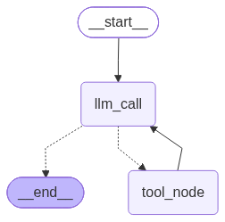

# Job Opportunity Chat Assistant

This project is a job-search assistant that helps users find relevant opportunities, understand required skills, and get a quick market snapshot for a given role and city. It combines:

- a Gradio chat interface (`app.py`)
- a LangGraph-based agent (`main_langchain.py`)
- a job listings API for real job retrieval
- a Chroma vector database for semantic role/skill matching


The app is designed around a simple idea: the model decides whether to answer directly or call a tool to fetch structured data before responding.

## Project purpose

The assistant is built to help with prompts like:

- "Give me Data Scientist listings in Toronto"
- "What skills do I need for an AI Engineer job?"
- "Show me architecture jobs in Toronto and give me sample listings"
- "What is the market like for Revit Designer in Montreal?"

It supports three main functions:

1. Fetching real job listings from an external API
2. Searching semantically related job titles and skills from a local database
3. Summarizing the local job market for a selected title and city

## High-level architecture

The app is split into three layers:

- User interface: `app.py`
- Agent orchestration: `main_langchain.py`
- Data services: job API + Chroma semantic search

The core agent loop is a LangGraph state machine:

- `START -> llm_call`
- `llm_call -> tool_node` when the model chooses to invoke a tool
- `tool_node -> llm_call` for a follow-up decision
- `llm_call -> END` when no more tool calls are needed



## Files in this module

- `app.py` — Gradio front-end for the chat experience
- `main_langchain.py` — LangGraph agent, tool definitions, and orchestration
- `prompts.py` — prompt templates for the agent behavior
- `normalize.py` — city/region normalization logic
- `utils.py` — response cleaning utilities
- `download_data.py` — data retrieval setup for the job-skill corpus
- `embeddings.ipynb` — notebook used to build the vector store
- `chromadb_store/` — persistent Chroma database
- `data/` — supporting data files

## Main agent workflow

The main orchestration is defined in `assignment_agent()` inside `main_langchain.py`.

The agent uses a `StateGraph` with the state:

- `messages`: conversation history
- `llm_calls`: count of LLM decisions

The graph defines two nodes:

- `llm_call`: invokes the LLM with the system prompt and conversation history
- `tool_node`: executes whichever tool the model selected

The decision rule is:

- If the last message contains `tool_calls`, continue to `tool_node`
- Otherwise, finish the run with `END`

This allows the system to be iterative: the LLM may call one or more tools before producing a final answer.

## Tooling and capabilities

The agent binds the following tools to the model:

### 1. `get_job_listings`

Purpose:
- Search the external job opportunities API by title, city, remote style, seniority, and result limit.

Inputs:
- `title`: required role name
- `city`: optional city, defaults to Toronto
- `remote`: optional remote/hybrid/onsite preference
- `seniority`: defaults to `mid,senior`
- `limit`: max results, capped at 5

Behavior:
- Normalizes the user city using `normalize_location()`.
- Tries a sequence of API requests with broader fallback parameters if needed.
- Returns cleanly formatted job listings using `clean_job_response()`.

### 2. `semantic_job_query`

Purpose:
- Query the Chroma job-skill database using semantic similarity.

Inputs:
- `query`: job title, skill, or description
- `n_results`: number of matches to return

Behavior:
- Loads the persistent collection `essential_skills`
- Uses Chroma's `query()` to fetch semantically similar role/skill documents
- Returns title, SOC code, distance, and raw document content

This is the component that helps answer "What skills do I need for this type of role?"

### 3. `get_job_market_summary`

Purpose:
- Produce a concise market snapshot for a job title in a city.

Inputs:
- `title`: required role name
- `city`: optional city
- `limit`: number of jobs to consider

Behavior:
- Calls the same jobs API
- Counts returned opportunities
- Identifies remote-friendly roles
- Extracts sample titles and creates a short summary

## LLM setup

The model is initialized with - OpenAI GPT-4o-mini

The model is bound with the three tools listed above, so it can decide whether to:

- answer directly from conversation context
- call a tool to gather structured job data
- run a semantic skill search
- use a market summary before drafting its final response

## Prompting strategy

The system prompt given to the model tells it to behave like a helpful and empathetic job search assistant. In practice, it is encouraged to:

- respond politely and supportively
- look for localized job listings
- use retrieval tools when the user asks for jobs or skill requirements
- avoid answering unrelated questions with tool usage as a guardrail. 

The prompt is deliberately simple and task-focused, keeping the agent grounded in utility rather than general chatter.

## Chat interface (`app.py`)

The user-facing app is a Gradio chat interface.

Core behavior:

- Takes the incoming user message and chat history
- Converts prior user/assistant messages into `HumanMessage` and `AIMessage` objects
- Appends the new user message
- Calls the agent with the conversation state
- Returns the final assistant message content

The interface is launched with:

```python
chat.launch()
```

It also includes a welcoming initial message that frames the assistant as a supportive job-search sidekick called "Sirius Black".

## Data and retrieval sources

### External job API

The app calls:

- `https://api.jobopportunitiesapi.org/v1/jobs`

It includes a bearer token if `JOB_API` is available in the environment.

### Semantic skill database

The collection used is:

- `essential_skills`

This is stored locally in:

- `./chromadb_store`

The dataset originates from a job-skill taxonomy and is embedded offline using batch processing and OpenAI embeddings.

## Environment variables

The app expects environment configuration such as:

- `OPENAI_API_KEY`
- `JOB_API`

The project loads secrets from `.env` and `.secrets` using `python-dotenv`.

## Setup and run

From the project root, make sure dependencies are installed and the environment is active.

Then run:

```bash
cd 05_src
python -m assignment_chat.app
```

## Summary

- LangGraph for multi-step reasoning
- tool-calling LLM behavior
- Gradio for a simple interactive UI
- external job APIs for live listings
- vector search for skill discovery
- Guard rail for unrelated queries

